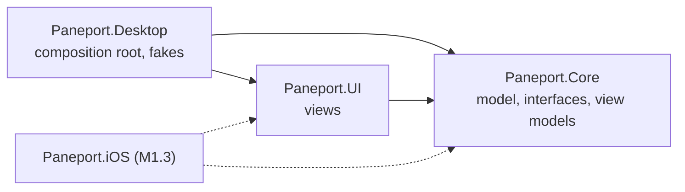

# App Shell

| Author | Timestamp (UTC) |
|---|---|
| Claude (Anthropic), for the Paneport project | 2026-10-29T17:40Z |

Back to the [design index](README.md).

This document records the design of Paneport's app shell: the domain model, service interfaces and view models in Paneport.Core, the views in Paneport.UI, and the desktop head with its fakes in Paneport.Desktop. Stage M0.3 wrote it (see the [L0 brief](stages/L0-foundation.md)). It completes the first design record that [solution-and-build.md](solution-and-build.md) gives these three projects. Where this document and a contract differ, the [contracts](../contracts/README.md) win.

## 1. Components and dependencies

| Component | Holds | Depends on |
|---|---|---|
| Paneport.Core | The domain model, the service interfaces, the secret value type, the Steam stub and the view models | No other project. The CommunityToolkit.Mvvm package for the view models. No platform API. |
| Paneport.UI | The application class, the main view, the four pages, the styles and the data templates | Paneport.Core; the Avalonia and Avalonia.Themes.Fluent packages |
| Paneport.Desktop | The composition root, the window, the fakes, and the sink that shows Avalonia's warnings in the terminal | Paneport.Core, Paneport.Steam (no code yet) and Paneport.UI; the Avalonia.Desktop package |

- The view models live in Paneport.Core and never reference Avalonia. Paneport.UI binds its views to them. The heads implement the interfaces and create everything in a composition root: Paneport.Desktop now, Paneport.iOS from M1.3. The directions are those of C-0004 section 2, and each test project's dependency direction test checks them.
- View models reach the native host only through the runtime host interface (C-0004 section 1).
- The main view is a control, not a window. The desktop head puts it in a window, and the iOS head shows it as its single main view (`avalonia_ui_layer.md` section 2.1).

## 2. Domain model

| Type | What it holds | Basis |
|---|---|---|
| `TitleId`, `TitleSource` | A title's identity: `steam-<appid>` for a Steam title, `local-<slug>` for any other | C-0008 section 1 |
| `Title` | Identity, display name, install state and launch path | C-0007 sections 4 and 5 |
| `InstallState`, `InstallStatus` | Not installed, downloading with its progress, installed, or update pending | C-0007 section 4 |
| `LaunchPath` | Not classified yet, Direct or Dock | C-0007 section 5, C-0008 section 2 |
| `HostAbiVersion` | The host interface version, with the major version in the high 16 bits and the minor in the low 16 | C-0005 section 1 |
| `MemoryBudget` | The memory limit, the available memory and the current footprint in bytes, and whether the limit reached the Game Mode level | C-0005 section 2 |
| `AppSettings`, `LocaleOption` | The app settings (section 4) | C-0005 section 2 |
| `Secret` | A secret value whose text form is redacted | C-0010 section 2 |

Rules that the types enforce:

- **Slugs.** C-0008 section 1 allows "lowercase letters, digits and single hyphens". The shell reads this as one or more groups of lowercase ASCII letters and digits joined by single hyphens, the pattern `^[a-z0-9]+(-[a-z0-9]+)*$`: no leading, trailing or double hyphen, and no letter outside ASCII, since the slug becomes a file name. M6.4's title schema must use the same pattern (section 10).
- **App IDs.** An app ID is never 0 and is written without leading zeros, so that each title has exactly one identity text and one compat file name. Parsing rejects anything else, including any character other than an ASCII digit. That covers a trailing NUL character, which the .NET integer parser would otherwise skip.
- **Local titles never take the Dock path.** A title not obtained through Steam can start only directly, and the app refuses to launch one that shows a Steam marker (C-0007 section 5, C-0008 section 5). `Title` rejects a local title with the Dock path.
- **Download progress** is a fraction from 0 to 1. The shell shows it as a whole percentage, rounded down once the binary error of the product is rounded off (0.29 gives 29%, not 28%), and an unfinished download never shows 100%.
- **ABI compatibility.** Two versions are compatible when their major versions match. The .NET side refuses to start on a different major version (C-0005 section 1); M1.3 adds that check at startup.
- **Memory sizes** are in bytes. The shell shows whole MB of 1,048,576 bytes, rounded down, the unit that C-0005 and C-0009 use for the memory limit.
- **Secrets.** `Secret.ToString()`, string interpolation, composite formatting and the debugger all give `[redacted]`. Only `Reveal()` returns the value, so every use of a secret is easy to find in review.

## 3. Interfaces

| Interface | Covers now | Desktop head | Real implementation |
|---|---|---|---|
| `IRuntimeHost` | The implementation's name, the ABI version and the memory budget | `FakeRuntimeHost` (section 6) | M1.3: a host adapter over Paneport.Interop, whose bindings M1.2 writes |
| `ILibraryService` | Listing the titles | `SampleLibrary` (section 6) | M7.1 builds the library from Steam; M6.5 adds imported titles. M1.3 uses an empty library until then. |
| `ISteamService` | The sign-in state only | `SignedOutSteamService`, from Paneport.Core | M2.3, in Paneport.Steam |
| `ISettingsStore` | Loading and saving `AppSettings` | `InMemorySettingsStore`, for one run | M1.3 (S1.3.5): a file in the settings folder of C-0004 section 4 |
| `ITokenStore` | Reading, writing and deleting the Steam refresh token | `InMemoryTokenStore`, for one run and never on disk | M1.3 (S1.3.6): the keychain (C-0004 section 4); M2.3 (S2.3.3) makes the Steam service use it |
| `ILog` | Writing a log line | `ConsoleLog`, to the terminal | M1.3: a sink in `Library/Caches/Paneport/` |
| `INavigator` | Opening a page on top of the current one | Not a head's: the shell implements it | The shell (section 5) |

- **Shape.** Each interface covers only what the shell shows now, so that later stages, which know more, can change it cheaply before the iOS head exists. The library service and the settings and token stores are asynchronous, with a cancellation token, because their real implementations wait on files, the keychain or the network. Three members are synchronous. The runtime host's reads are cheap calls that any thread may make, `pp_abi_version` and `pp_memory_get_budget` (C-0005 section 2). The Steam sign-in state is a plain property until M2.3 designs sign-in. `ILog.Write` returns at once, so that logging never waits.
- **`AppServices`** collects the six services that a head provides, and the shell takes it. The token store has no user yet; the Steam sign-in of M2.3 is the first.
- **The Steam stub** `SignedOutSteamService` is in Paneport.Core, not in a head, because both heads use it until M2.3: the desktop head now, and the iOS head of M1.3.
- **Logging.** A log line never holds a password, token or other personal data (C-0010 section 2). Where the shell logs a failure, it writes the exception's type and not its message, because a message can hold a local path. A `Secret` written into a message shows as `[redacted]`.

## 4. Settings

| Setting | Values | Default | Used by |
|---|---|---|---|
| Locale | A BCP 47 language tag from the list below | `en-US` | The session configuration of `pp_session_start`, which takes the locale from the app settings (C-0005 section 2) |

This is every setting so far. A setting is saved as soon as the user changes it; there is no Save button. A newer change cancels a save that has not finished and saves in its place, which is not logged as a failure. The choice stays disabled until the page has loaded, because the loaded value would overwrite an earlier choice. Opening the Settings page again shows the value from the store.

The Settings page offers these locales, each with an English display name: `zh-CN`, `zh-TW`, `en-GB`, `en-US`, `fr-FR`, `de-DE`, `it-IT`, `ja-JP`, `ko-KR`, `pl-PL`, `pt-BR`, `ru-RU` and `es-ES`. The names are written out in `LocaleOption` rather than read from `CultureInfo`, because the iOS build may run in globalization-invariant mode, where most cultures are missing. A saved locale that is not on the list leaves no choice marked instead of failing.

## 5. View models, navigation and views

- **Shell.** `ShellViewModel` offers the sections Library, Settings and Diagnostics, keeps a back stack, and shows one page at a time. It starts on the Library section; the head runs its `StartCommand` once the view is shown, which loads the Library.
- **Sections.** The navigation bar's entries are buttons that run `OpenSectionCommand`, and each `NavigationEntry` tells the view whether to mark its button. Opening a section, even the one already marked, shows a new page for it and clears the back stack. Choosing Library on a title's details therefore returns to the list, as tapping the current tab does on a phone. A new page reads its data from the services, which is why a changed setting survives a visit to another page.
- **Pushed pages.** A page opens another page through `INavigator.PushAsync`, which puts the current page on the back stack. Going back returns to that page as it was, without loading it again. The Library opens Title details this way.
- **Loading.** The shell loads each page once, when it first shows it. While it loads, the main view shows a progress bar. If the load fails, the main view shows "This page could not load its data." and the failure is logged (section 3).
- **A newer navigation wins.** `OpenSectionCommand` stays available while a page loads, so a slow page never disables the navigation bar. A newer run cancels the load of the page that it replaces, through the command's token, and the shell treats that cancellation as a normal end (section 7).
- **Pages.** Library lists the titles sorted by name, each with its identity, install state and launch path; choosing one opens Title details, which also shows the source and what the launch path means. Settings shows the locale and the Steam sign-in state. Diagnostics names the host implementation, so that a fake value is never taken for a device reading, and shows the ABI version and the memory budget, which Refresh reads again.
- **Main view.** A navigation bar at the bottom, a header with a Back button and the page's heading, the progress bar and error text, and the page. The heading trims a long title name; Title details shows the whole name, wrapped. The layout works at desktop and phone widths alike.
- **Titles in the Library are buttons**, not list selections, so that arrow keys never open a title and a click, a tap or Enter does.
- **View matching.** `App.axaml` holds one data template per page view model type, and the main view's content control picks the page's view through them. The match is by type and compiled; nothing looks a view up by name. Avalonia's template view locator does, through `Type.GetType`, which the trimming analyzers reject.
- **Bindings** are compiled, the default in Avalonia 12 (`avalonia_ui_layer.md` section 2.4), so a wrong path fails the build. A title's button reaches the Library's command through a typed cast of the page's data context. XAML is compiled at build time and never loaded at run time (`avalonia_ui_layer.md` section 3.4).
- **Generators.** The view models use CommunityToolkit.Mvvm's `[ObservableProperty]` on partial properties and `[RelayCommand]` (C-0010 section 2). Partial properties need C# 14's `field` keyword, which CommunityToolkit.Mvvm accepts without the preview language version from 8.4.1 on; the solution uses 8.4.2.

## 6. Desktop head and fakes

The composition root, `CompositionRoot.CreateMainWindow`, creates the log, the fakes, the shell over them, and the window titled Paneport, 1,024 by 720 and at least 400 by 400, that hosts the main view. It runs the shell's `StartCommand` when the window opens. Before any view exists, it gives Avalonia's logger `AvaloniaLogForwarder`, which passes what Avalonia logs at warning level or above, such as a binding that fails at run time, to the head's log. Without a sink, Avalonia drops those lines.

**Fake host.** `FakeRuntimeHost` reports the memory limit that C-0009 section 4 cites without Game Mode, and a footprint and available memory that add up to it, as the host's estimate does (C-0005 section 2). The Diagnostics page shows:

| Field | Value |
|---|---|
| Host | Fake host (desktop head sample values, not a device reading) |
| Host ABI version | 1.0 |
| Memory limit | 6,144 MB |
| Available memory | 5,632 MB |
| Current footprint | 512 MB |
| Game Mode level | Not reached |

ABI version 1.0 stands for the first version of the host headers; M1.2 sets the real one.

**Sample titles.** `SampleLibrary` holds these titles, in the order the Library shows them. They cover every install state and launch path, one local title and one very long name.

| Title | Identity | Install state | Launch path |
|---|---|---|---|
| Brasswing Courier | `steam-4000000010` | Installed | Direct |
| Lanternfall Expedition | `steam-4000000020` | Downloading, 42% | Dock |
| Pocket Orrery | `local-pocket-orrery` | Installed | Direct |
| Quarry of the Nine Kites | `steam-4000000030` | Update pending | Dock |
| Saltmarsh Signal Tower | `steam-4000000040` | Not installed | Not classified yet |
| The Unabridged Annals of Captain Wobblethorpe and the Seventeen Clockwork Lighthouses of the Drifting Archipelago: Definitive Edition | `steam-4000000050` | Installed | Not classified yet |

The titles were invented for Paneport and carry no game artwork or other game material (C-0008 section 5). Their app IDs lie far above any ID that Steam has assigned, so none names a real app. Nothing in the shell suggests an affiliation with Microsoft, Valve or Apple (C-0001 section 7 item 4).

**Other fakes.** The Steam service is the signed-out stub. `InMemorySettingsStore` and `InMemoryTokenStore` keep their values in memory for one run; the desktop head never writes a Steam token to disk (C-0004 section 2, C-0007 section 3). `ConsoleLog` writes each line to the terminal that runs the head, as `HH:mm:ss Level Source: message` with the time in UTC.

## 7. Threading

- The view models are created and used on the UI thread, which is the main thread on iOS (C-0004 section 1). Their properties are bound there.
- The library service and the settings and token stores are asynchronous (section 3). A view model awaits them without `ConfigureAwait(false)`, so it resumes on the UI thread through Avalonia's synchronization context, whichever thread the service finished on. The desktop fakes finish at once; the test fakes can hold a load or a save open, as a store on disk would.
- Commands that await a service are asynchronous commands from the generators. No code of ours is `async void` (C-0010 section 2). The one event handler with code, the desktop head's `Opened` handler, is synchronous and only starts a command.
- A newer run of such a command cancels the older run through its token. The shell's page loads and the Settings page's saves treat that cancellation as a normal end. Let through, it would fail the older run, and the generated command rethrows a failed run on the UI thread, where nothing handles it.
- The heads start the shell once its view is shown, so that the first load runs on the UI thread with its synchronization context in place.
- `ILog` implementations accept calls from any thread.

## 8. Tests

| Project | What it covers |
|---|---|
| Paneport.Core.Tests | Identities and slugs (C-0008 section 1), including a trailing NUL character; install states; titles, including a local title on the Dock path; ABI decoding and compatibility (C-0005 section 1); the four budget values; the secret's text forms and a log line that holds one; settings and locales; the services record; the Steam stub; each view model, including navigating to every page and back, choosing the marked section, a newer navigation while a page loads, a setting that round-trips through the store, a choice while Settings loads and a save that a newer change supersedes, exact download percentages, and Diagnostics with the Game Mode level reached and not reached |
| Paneport.UI.Tests | Headless tests of the same shell that the desktop head shows: the navigation entries, every title with its state and launch path, the long name wrapping on a phone-sized window, opening a title and going back, choosing Library on a title's details, a changed locale that survives a visit to another page (the twin of L0 acceptance step 8), the locale choice waiting for the load, another section opened while Settings loads, the host's values on Diagnostics, and one view per page view model |

- **Fakes.** The tests use hand-written fakes (C-0011 section 1) in `tests/Shared/Fakes`, which both test projects compile in, so neither depends on the other (C-0004 section 2). Their titles are made up and their app IDs, from 4,100,000,010, are as far from real ones as the samples'.
- **Twin of the desktop head.** `ShellHarness` builds the shell the way the composition root does, over the test fakes, and drives it with the mouse.
- **Binding errors.** Avalonia reports a binding that fails at run time through its logger, in the Binding area. `AvaloniaWarnings` installs a sink in that logger for the length of a test, and every headless test ends by asserting that nothing was logged at warning level or above. Two planted errors, a path through a null value and a value that cannot be converted, were each logged in the Binding area and failed the test. Because the logger is global, the UI tests run one at a time.
- **No pixels.** The tests check structure and bound values, not rendering, so fonts that differ between the Windows and Ubuntu runners do not matter.

## 9. Trimming and AOT

- Paneport.Core and Paneport.UI set `IsAotCompatible`, so the trimming and AOT analyzers check them, including the code that the MVVM generators write. The build reports no warning.
- A trimmed, self-contained publish for `win-x64` that rooted Paneport.Core and Paneport.UI with `TrimmerRootAssembly`, with `TrimmerSingleWarn` set to false so that every warning shows, reported no warning from CommunityToolkit.Mvvm, Avalonia or our code. It ran in a scratch copy of the repository, not in CI. M0.2's trimmed test app repeats the check in CI with all four libraries.
- Views are matched by type and XAML is compiled, so no view or XAML is looked up at run time.

## 10. Open questions

- **Slug pattern.** Section 2 reads C-0008 section 1 strictly. M6.4's schema implements the same pattern, or the two are aligned through C-0008 if recelilious reads the rule differently.
- **Expected ABI version.** The major version the .NET side expects comes with M1.2's headers. M1.3 checks it at startup and shows the compatibility on Diagnostics.
- **Token store shape.** M1.3 keeps the account name next to the refresh token, and its developer menu writes a test item under its own key, so `ITokenStore` will grow there (M1.3, M7.1).
- **The token in managed memory.** A .NET string cannot be wiped. C-0005 section 2 makes the host zero its own copy; whether the managed side keeps the token as bytes it can clear is for M2.3 to decide.
- **A failed save.** Today only the log records it. How the Settings page shows it is decided with the first store that can fail, the settings file of M1.3.
- **Overlapping saves.** A newer change cancels the save before it. The settings file of M1.3 must stop a cancelled save before it replaces the file, or serialize its saves; otherwise an older save could land last.
- **The locale in a session.** Whether Wine needs another form of the tag, such as `de_DE.UTF-8`, is for the session flow of M6.5, which converts it.
- **Larger libraries.** The Library realizes every title. When the library comes from Steam (M7.1), it moves to a virtualizing panel, and download progress needs change notifications, which `TitleViewModel` does not raise yet.
- **The phone.** The layout works at phone width on the headless platform. Safe areas, the on-screen keyboard and the overlay are checked on the device from M1.3 and M2.1.

## 11. Sources

Public material consulted (C-0001 section 6):

- CommunityToolkit.Mvvm, `[ObservableProperty]`: <https://learn.microsoft.com/en-us/dotnet/communitytoolkit/mvvm/generators/observableproperty>
- CommunityToolkit.Mvvm, `[RelayCommand]`: <https://learn.microsoft.com/en-us/dotnet/communitytoolkit/mvvm/generators/relaycommand>
- CommunityToolkit.Mvvm, `AsyncRelayCommand`: <https://learn.microsoft.com/en-us/dotnet/communitytoolkit/mvvm/asyncrelaycommand>
- CommunityToolkit 8.4.1 release notes, C# 14 partial properties: <https://github.com/CommunityToolkit/dotnet/releases/tag/v8.4.1>
- CommunityToolkit.Mvvm 8.4.2 on NuGet: <https://www.nuget.org/packages/CommunityToolkit.Mvvm/8.4.2>
- C# `field` keyword: <https://learn.microsoft.com/en-us/dotnet/csharp/language-reference/keywords/field>
- Avalonia 12 breaking changes, compiled bindings by default: <https://docs.avaloniaui.net/docs/avalonia12-breaking-changes>
- Avalonia compiled bindings: <https://docs.avaloniaui.net/docs/data-binding/compiled-bindings>
- Avalonia data templates: <https://docs.avaloniaui.net/docs/data-templates/introduction-to-data-templates>
- Avalonia view locator: <https://docs.avaloniaui.net/docs/data-templates/view-locator>
- Avalonia logging of errors and warnings: <https://docs.avaloniaui.net/docs/app-development/logging-errors-and-warnings>
- Avalonia headless testing with xUnit: <https://docs.avaloniaui.net/docs/testing/headless-xunit>
- Trimming options, including `TrimmerSingleWarn` and `TrimmerRootAssembly`: <https://learn.microsoft.com/en-us/dotnet/core/deploying/trimming/trimming-options>
- Globalization-invariant mode: <https://learn.microsoft.com/en-us/dotnet/core/runtime-config/globalization>
- BCP 47 language tags (RFC 5646): <https://www.rfc-editor.org/info/rfc5646>
- Research note `avalonia_ui_layer.md`, sections 1, 2.1, 2.4 and 3.4: [avalonia_ui_layer.md](../research/avalonia_ui_layer.md)
- Roadmap, the solution layout in the section on build and signing: [roadmap-2026-10.md](../research/roadmap-2026-10.md)
