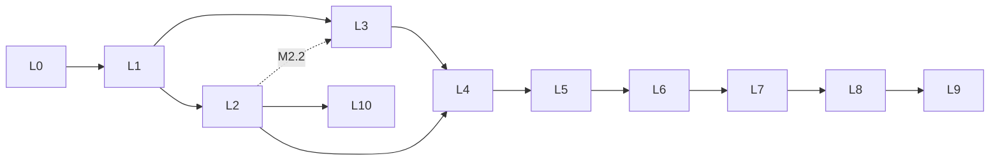
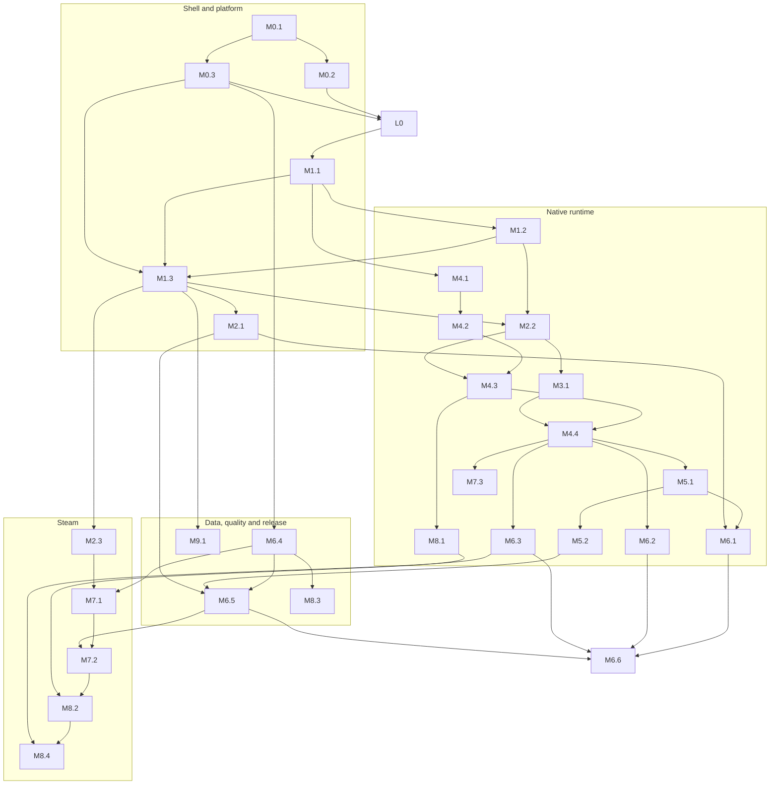

# Paneport Development Plan

| Author | Timestamp (UTC) |
|---|---|
| Claude (Anthropic), for the Paneport project | 2026-10-29T00:46Z |

> This plan splits Paneport's development into stages that can each be verified. It is a living document: stage sessions update the status and session log of their own stage. It does not override the [contracts](../contracts/README.md). Where the two differ, the contracts win, and any change the plan needs in a contract goes through the contract process first.

## 1. How to use this plan

- This file defines the three stage levels, how a stage session works, the prerequisites and decisions, the full stage map with its dependencies, and the engineering choices that set the order of work.
- Each Large stage has a brief in [stages/](stages/README.md). The brief holds that stage's acceptance steps and the detailed briefs of the Medium and Small stages inside it.
- recelilious starts one conversation per Medium or Large stage with the kickoff prompt in section 3.2. Small stages are done inside the session of their parent.

## 2. Stage levels

### 2.1 Definitions

| Level | Prefix | What it is | How it is verified | Who accepts it |
|---|---|---|---|---|
| Large | `L` | A milestone with a visible result that recelilious can try by hand, on the iPhone or on Windows. | Manual acceptance steps written in the brief, and an evidence record under `docs/evidence/` (C-0012 section 4). A Large stage that matches a C-0012 gate uses that gate's criteria. | recelilious |
| Medium | `M` | A substantial piece of work that is not visible on its own, often at kernel level: a toolchain, a runtime subsystem, a protocol. | Scripts and automated tests: CI jobs, test suites and the macOS harness (section 7.1). The brief states the commands and the pass criteria. | Claude verifies it; recelilious reviews the pull request. |
| Small | `S` | A self-contained module with its own purpose and interface. | Its own check where one is possible: a unit test, a build, a script run or a review checklist. It may not be fully verifiable on its own. | Checked inside its parent's session. |

### 2.2 Nesting

- A Large stage contains Medium stages, Small stages or both, plus its own integration work.
- A Medium stage contains Small stages, plus its own glue work.
- A Small stage contains nothing.
- Containment is optional. A Small stage may sit directly under a Large stage. A Medium stage may stand alone when no Large stage fits; its brief then says `Parent: none` and how it is checked.

### 2.3 Identifiers

| Form | Meaning | Example |
|---|---|---|
| `L<n>` | Large stage n | `L4` |
| `M<n>.<m>` | Medium stage m inside `L<n>` | `M4.3` |
| `S<n>.<m>.<k>` | Small stage k inside `M<n>.<m>` | `S4.3.2` |
| `S<n>.0.<k>` | Small stage k directly inside `L<n>` | `S4.0.1` |

An identifier never changes once its stage has started. A stage added later takes the next free number. A stage that is dropped keeps its number with the status `Dropped`.

### 2.4 Status values

| Status | Meaning |
|---|---|
| Planned | Not started. |
| Ready | Every stage it depends on is done, and the decisions it needs are made. |
| In progress | A session is working on it. |
| Blocked | Waiting on a decision, a dependency or an outside event; the reason is written next to it. |
| Done | A Medium or Small stage whose verification passed and whose branch is merged. |
| Accepted | A Large stage that recelilious accepted and whose evidence record is merged. |
| Dropped | Will not be done; the reason is written next to it. |

### 2.5 Sizes

Sizes are rough and mainly useful for comparing stages.

| Size | Expected sessions |
|---|---|
| XS | Part of one session |
| S | One session |
| M | One or two sessions |
| L | Two to four sessions |
| XL | Four or more sessions |

## 3. Working in stage sessions

### 3.1 One session per Medium or Large stage

- Each Medium or Large stage gets its own conversation. A stage that needs more than one session continues in a new conversation that starts from the stage's session log.
- Small stages are done in the session of their parent.
- A Large stage's own session is its integration session. It starts when all of the stage's Medium stages are done, wires their results together, does the stage's own Small stages, prepares the acceptance steps and the evidence record template, and runs the checks that need everything together.
- Sessions for stages that do not depend on each other can run in parallel (section 6.3).

### 3.2 Kickoff prompt

recelilious starts a stage session with this prompt, filling in the stage identifier:

```
Paneport stage session: <stage ID>.
Read CLAUDE.md, docs/contracts/README.md and the contracts the stage brief lists,
docs/design/development-plan.md, and the brief of <stage ID> in docs/design/stages/.
Check that every stage it depends on is Done or Accepted; if one is not, stop and tell me.
Work on the branch the brief names. Follow the brief's scope, verify as it says,
update the stage's status and session log, commit and push as C-0002 says,
and finish with a short summary in Chinese of what changed and what I should check.
```

A continuation session uses the same prompt with `Continue <stage ID>` in its first line.

### 3.3 Session checklist

At the start:

1. Read the files the kickoff prompt names.
2. Confirm that every dependency is Done or Accepted. If one is not, stop and report.
3. Confirm that the decisions the brief needs are recorded (section 4.2). If one is not, ask recelilious.
4. Update `main`, create or check out the stage branch, and set the stage's status to In progress.

During the work:

- Stay within the brief's scope. Work outside it goes into the session log as a proposed follow-up, or becomes a new stage once recelilious agrees.
- Every new component gets the design document that C-0012 section 1 requires, under `docs/design/`.
- A contract change goes on its own `contract/<summary>` branch, in its own commit, and is pushed only after recelilious has reviewed it (C-0012 section 2). A stage branch never carries contract commits.
- Changes inside a fork are committed in that fork repository on a `paneport/<stage ID>` branch and pushed there. The stage branch of this repository then moves the submodule pointer.

At the end:

1. Run the brief's verification and record the results in the pull request.
2. Update the stage's status and append to its session log: the date in UTC, what was done, what is left, and what the next session must know. When a Medium stage's verification passed and only the merge is left of its Done-when list, set it and its finished Small stages to Done in the branch's last commit. The status then reaches `main` with the merge, so the stages that depend on it can start as soon as recelilious merges. A Large stage stays In progress until recelilious accepts it; the commit that fills in its evidence record with a Pass verdict sets it to Accepted. A stage that is not finished stays In progress, or becomes Blocked with the reason.
3. Commit following C-0002 and push the stage branch. Open a pull request unless recelilious asks otherwise.
4. Give recelilious a short summary in Chinese, including the manual checks for a Large stage.

### 3.4 Branches and commits

- Stage branches are named `<type>/<stage ID>-<summary>`, with the identifier in lowercase and its dots replaced by hyphens, for example `feat/m4-3-single-process-wine`.
- Commit messages follow C-0002. The body ends with a `Stage: <stage ID>` line, placed before the co-author trailer.
- recelilious merges stage branches (C-0002 section 2).

## 4. Prerequisites and decisions

### 4.1 Environment

| Need | First needed by | Notes |
|---|---|---|
| Windows 11 with the .NET 10 SDK and VS 2026 or Rider | L0 | C-0009 section 1. |
| GitHub Actions on the public repository | L0 | Standard runners are free while the repository is public (C-0011 section 4). |
| An Apple silicon Mac with the pinned Xcode | L1 (recommended), M4.2 (strongly recommended) | CI can build the app without a local Mac. Debugging the runtime from M4.2 on without a Mac, Xcode and Instruments is very slow. |
| An iPhone 17 Pro, 17 Pro Max, 18 Pro or 18 Pro Max with Developer Mode | L1 | C-0001 section 2. |
| An Apple ID for signing | L1 | A free Personal Team allows three sideloaded apps, and AltStore, StikDebug and Paneport already use all three. A paid account removes that limit and gives one-year profiles. |
| AltStore 2.2 or later on Windows | L1 | The supported install route from Windows (C-0009 section 5). |
| StikDebug, a pairing file and LocalDevVPN on the iPhone | L3 | C-0006. Pairing files are never committed. |
| A Steam account with suitable games | M2.3, L6 to L8 | The test titles are chosen in decision D6. |

### 4.2 Decisions for recelilious

The last column holds recelilious's answer and the date it was given. A stage session checks it before it starts (section 3.3).

| ID | Decision | Needed before | Options or default | Recorded |
|---|---|---|---|---|
| D1 | Is a local Apple silicon Mac available? | M1.1, M4.2 | Without one, every Mac step runs in CI, and runtime debugging is much slower. | No local Mac (2026-10-30). Every Mac step runs in CI. |
| D2 | Free or paid Apple developer account? | L1 | Paid is recommended: no three-app limit, one-year profiles, extended virtual addressing. | Free account (2026-10-30). |
| D3 | The app's bundle identifier | M1.3 | C-0009 section 4 leaves it to recelilious. | Open. |
| D4 | Who creates the fork repositories `Paneport-wine`, `Paneport-FEX` and `Paneport-dxmt` on GitHub | M4.1 | recelilious creates them, or authorizes Claude to create them with `gh`. | Under recelilious's GitHub account (2026-10-30). M4.1 confirms the names with recelilious, then creates them with `gh`. |
| D5 | The upstream versions of Wine, FEX-Emu and DXMT to start from | M4.1 | M4.1 proposes versions with reasons; recelilious approves. | The newest versions that work together (2026-10-30). M4.1 proposes them with reasons; recelilious approves. |
| D6 | Test titles from recelilious's own library | M6.6, L7, L8 | A 2D or indie DX11 game (L6); a DRM-free Steam game and a 32-bit or fixed-base game (L7); a SteamStub-protected AAA game from the 2010s and a game that needs a launcher service (L8). | Open. |
| D7 | Whether the `ios` CI job runs on every pull request or only before merging | M1.1 | C-0011 section 4 leaves it to recelilious once the job's run time is known. | Only before merging (2026-10-30). |
| D8 | Whether the JsonSchema.Net license terms are acceptable | M8.3 | If not, another validator is chosen (C-0011 section 5). | Open. |
| D9 | How the app asks the user to relaunch after a session | M6.5 | C-0004 section 1 leaves it to a design document. | Open. |
| D10 | Whether exporting saves to `Documents/` is enough while saves are not backed up | L7 | C-0004 section 4 open item. | Open. |
| D11 | The paths for Direct3D 9, Direct3D 12 and 32-bit guests (FEX WoW64 or Box64) | M7.3, then after L6 | C-0004 section 2 open items. M7.3 settles 32-bit guests. | Open. |
| D12 | Whether the device test app shares the main app's bundle identifier | M1.3 | Sharing it keeps the free account's three-app limit; recommended. | Shared (2026-10-30). |
| D13 | How the Steam sign-in QR code is drawn | M2.3 (S2.3.10) | A QR code library registered under C-0003, or a small encoder of our own. | Open. |

## 5. Stage map

### 5.1 Large stages

| Stage | Title | What recelilious sees | C-0012 gate | Depends on | Brief |
|---|---|---|---|---|---|
| L0 | Foundation | The Paneport shell running on Windows with sample data, and green CI | none | none | [L0](stages/L0-foundation.md) |
| L1 | Paneport on the iPhone | The app installed on the iPhone, with a diagnostics page showing the native host and the memory limit | none | L0 | [L1](stages/L1-app-on-iphone.md) |
| L2 | Phase 0 gates | The overlay test, the four-hour signal test and a Steam sign-in with a small download, all on the iPhone | Phase 0 | L1 | [L2](stages/L2-phase-0-gates.md) |
| L3 | JIT on the iPhone | JIT enabled through StikDebug, and a passing JIT self-test | none | L1, M2.2 | [L3](stages/L3-jit-on-iphone.md) |
| L4 | First Windows program on the iPhone | A Windows x86-64 test program running inside the app, with its output in an in-app console | none | L2, L3 | [L4](stages/L4-first-windows-program.md) |
| L5 | One triangle | A Direct3D 11 triangle rendered full screen on the iPhone | Phase 1 | L4 | [L5](stages/L5-one-triangle.md) |
| L6 | A 2D game | An imported 2D or indie DX11 game played for 10 minutes | Phase 2 | L5 | [L6](stages/L6-2d-game.md) |
| L7 | Steam library and downloads | Signing in, browsing the library, downloading a DRM-free game and playing it | Phase 3 | L6, M2.3 | [L7](stages/L7-steam-library.md) |
| L8 | Dock alpha | A SteamStub-protected game launched through the Dock host | Phase 4 | L7 | [L8](stages/L8-dock-alpha.md) |
| L9 | First release | Version 0.1.0 installed from a GitHub release, with its open-source licenses screen | Release acceptance (C-0012 section 5) | L8 | [L9](stages/L9-first-release.md) |
| L10 | Runtime migration to CoreCLR | The app working on CoreCLR, with the signal test passing again | Runtime migration, before 2027-05-11 | L2, and .NET 11 for iOS released | [L10](stages/L10-coreclr-migration.md) |

### 5.2 Medium stages

| Stage | Title | Parent | Depends on | Size | Verified by |
|---|---|---|---|---|---|
| M0.1 | Solution scaffold and repository hygiene | L0 | none | M | `dotnet` build, test and format check; REUSE |
| M0.2 | Repository checks and CI | L0 | M0.1 | M | CI jobs on a pull request, including a planted failure |
| M0.3 | Shell skeleton with a fake host | L0 | M0.1 | M | Headless UI tests |
| M1.1 | macOS build environment and the iOS CI job | L1 | L0; D1, D7 | M | The `ios` CI job produces an app |
| M1.2 | Native host skeleton and interface conformance | L1 | M1.1 | L | CTest with sanitizers; the interface conformance test |
| M1.3 | iOS app head | L1 | M1.1, M1.2, M0.3; D3, D12 | L | The `ios` CI job produces an ad-hoc-signed `.ipa` |
| M2.1 | Overlay gate | L2 | L1 | M | Hit-test unit tests; the device gate |
| M2.2 | Signal dispatcher | L2 | M1.2, M1.3 | L | Routing and Mach tests with CTest on macOS; the device gate |
| M2.3 | SteamKit2 on the device | L2 | M1.3, M0.3; D13 | L | Unit tests with fakes; a desktop run; the device gate |
| M3.1 | JIT provider and broker script | L3 | M2.2, M1.3 | L | macOS tests with a MAP_JIT provider; device acceptance |
| M4.1 | Forks, submodules and toolchains | L4 | M1.1; D4, D5 | M | A fresh clone builds the first fork targets |
| M4.2 | ARM64EC Wine with FEX on macOS | L4 | M4.1 | XL | Win32 test programs pass on the macOS harness |
| M4.3 | Single-process Wine on macOS | L4 | M4.2, M2.2 | XL | The same tests in single-process mode, with fork and exec trapped |
| M4.4 | Runtime on iOS | L4 | M4.3, M3.1, M1.3 | XL | iOS builds and bundle checks in CI; device acceptance |
| M5.1 | iOS display driver | L5 | M4.4 | L | The harness renders into a layer it provides |
| M5.2 | DXMT on the runtime | L5 | M5.1 | L | Triangle pixels checked on the macOS harness |
| M6.1 | Input stack | L6 | M5.1, M2.1 | L | Synthetic input read back by a Win32 test program |
| M6.2 | Audio stack | L6 | M4.4 | M | An audio test program; logic tests on macOS |
| M6.3 | Memory governor and file-backed tier | L6 | M4.4 | L | Policy tests on macOS; device measurements |
| M6.4 | Compatibility database core | L6 | M0.3 | M | Schema and loader tests |
| M6.5 | Game import and session flow | L6 | M6.4, M5.2, M2.1; D9 | L | Classifier tests with synthetic PE files; UI tests |
| M6.6 | Performance pass for the test game | L6 | M6.1, M6.2, M6.3, M6.5; D6 | L | Frame-time and memory measurements |
| M7.1 | Sign-in, library and downloads | L7 | M2.3, M6.4 | L | Tests with fake services; a desktop download |
| M7.2 | Classification and direct launch of Steam titles | L7 | M7.1, M6.5 | M | Classifier and launch-decision tests |
| M7.3 | 32-bit and fixed-base programs | L7 | M4.4; D11 | L | i686 and fixed-base test programs on the harness |
| M8.1 | Multiple pseudo-processes | L8 | M4.3 | XL | Multi-process test programs on the harness |
| M8.2 | Dock host | L8 | M8.1, M7.1, M7.2 | XL | Unit tests with fakes; device runs only |
| M8.3 | Compatibility checks and reports | L8 | M6.4; D8 | M | The CI compatibility check, with failing fixtures |
| M8.4 | AAA performance and launcher-service titles | L8 | M8.1, M8.2, M6.3; D6 | L | Measurements on the device |
| M9.1 | Release workflow and compliance artifacts | L9 | M1.3 (the release itself waits for L8) | L | A dry-run release produces every artifact |
| M10.1 | Signals and threads on CoreCLR | L10 | L2, and .NET 11 for iOS released | M | Contract changes; dispatcher tests with CoreCLR on macOS |
| M10.2 | Build and runtime migration | L10 | M10.1 | L | Every CI job on .NET 11; the device gate |

Small stages are listed in each Large stage's brief.

## 6. Dependencies and order

### 6.1 Large stages



### 6.2 Medium stages by track



### 6.3 Suggested order of sessions

Stages in the same wave do not depend on each other and can run in parallel. A later wave can start a stage as soon as that stage's own dependencies are done.

| Wave | Stages |
|---|---|
| 1 | M0.1 |
| 2 | M0.2, M0.3 |
| 3 | L0, M6.4 |
| 4 | M1.1 |
| 5 | M1.2, M4.1 |
| 6 | M1.3, M4.2 |
| 7 | L1, M2.2, M2.3 |
| 8 | M2.1, M3.1, M4.3, M7.1, M8.3, M9.1 |
| 9 | L2, L3, M4.4, M8.1 |
| 10 | L4, M5.1, M6.2, M6.3, M7.3 |
| 11 | M5.2, M6.1 |
| 12 | L5, M6.5 |
| 13 | M6.6, M7.2 |
| 14 | L6, M8.2 |
| 15 | L7, M8.4 |
| 16 | L8 |
| 17 | L9 |
| Before 2027-05-11 | M10.1, M10.2, L10 |

The critical path runs through the native runtime: M0.1, M1.1, M4.1, M4.2, M4.3, M4.4, M5.1, M5.2, M6.5, M6.6, L6, M7.2, L7, M8.2, M8.4, L8. M4.1 should start as soon as M1.1 is done, in parallel with the work on L1 to L3.

## 7. Engineering choices that shape the plan

### 7.1 The macOS harness

The runtime is first brought up on macOS on Apple silicon. macOS shares the XNU kernel, Mach, 16 KB pages and Metal with iOS, but it allows a debugger, `MAP_JIT` with the same dual-mapping layout the iOS code pool uses, and automated runs on GitHub's Apple silicon runners. A small harness program in `tests/runtime/`, our own MIT code, starts the native host and a Wine session on macOS, runs Win32 test programs and checks their output.

- The harness is how Medium stages M4.2 to M8.1 are verified by script.
- Code that needs UIKit stays in Paneport.iOS. The iOS display driver uses only QuartzCore, Metal and the Wine bridge, so it runs inside the harness with a layer the harness provides (M5.1).
- In single-process mode the harness traps `fork`, `exec` and `posix_spawn`, so a test fails if anything calls them (M4.3).
- Running the harness in CI needs a change to C-0011 that adds a job for it. M4.2 proposes that change.

### 7.2 Our own Win32 test programs

`tests/win32/` holds small C programs that we write and build with llvm-mingw for x86-64 and i686: console output, CPU features, a checksum benchmark, structured exception handling, threads, file I/O, an XInput reader, an audio tone, a Direct3D 11 triangle and multi-process tests. Medium stages never need third-party binaries. Real games appear only in Large-stage acceptance, on recelilious's own devices (C-0001 section 7).

### 7.3 The device test app

`tests/device` builds a test flavor of the app with the developer screens the gates use. With decision D12 it shares the main app's bundle identifier, so it replaces the main app when installed and fits the free account's three-app limit; keychain items survive the switch.

### 7.4 One Wine prefix built ahead of time

On iOS, `wineboot` cannot run as a separate process. The planned approach builds a template prefix on the macOS harness in CI, ships it in the app and copies it into `Library/Application Support/Paneport/prefixes/` on first launch. M4.3's design document makes the final choice between this and running `wineboot` in-process.

### 7.5 Wine's built-in runtime libraries first

Games first use Wine's built-in C and C++ runtime libraries. Provisioning Microsoft's redistributable runtimes on the device stays in the backlog (section 10) unless a test title needs it.

### 7.6 Valve binaries stay off CI

Tests that need Valve's client run only on recelilious's own devices. CI uses fakes and test doubles that we write (C-0001 section 7, C-0007 section 6).

### 7.7 Design documents and evidence

- Every component gets its design document in `docs/design/` before or with its first code (C-0012 section 1 item 8). Each brief names the documents its stage writes.
- Every Large stage ends with an evidence record (C-0012 section 4). The gate table in `docs/evidence/README.md` is created with the first evidence record (S2.0.1).

## 8. Contract changes the plan expects

Each of these goes through the contract process (C-0012 section 2) when its stage reaches it.

| Stage | Contract | Expected change |
|---|---|---|
| M0.1, M0.2 | C-0003 | Register any package or GitHub Action that the register does not list yet, before it is added. |
| M1.3 | C-0011 | Clarify that the `ios` job may ad-hoc sign the `.ipa` it uploads, with no Apple identity, so that CI builds can be sideloaded with their entitlements. C-0009 section 6 already describes the same signing for releases. |
| M2.3 | C-0003 | Register the SteamKit2 dependencies that have no row yet, such as ZstdSharp.Port, and a QR code library if one is chosen. |
| M4.1 | C-0003 | Register the build tools the forks need, such as Python, bison, flex and autoconf, record llvm-mingw's license, and record the mingw-w64 runtime review. |
| M4.2 | C-0011 | Add a `runtime` CI job that builds the forks and runs the macOS harness. |
| M4.2 | C-0004 | Add `tests/runtime/` and `tests/win32/` to the repository layout. |
| M4.4 | C-0009 | Add bundle locations for the template prefix and the bundled test programs. If PE code pages must come from the JIT pool, also C-0005 section 3 or C-0006 section 3. |
| M5.2 | C-0003 | Register any LLVM libraries that DXMT's Mach-O side links. |
| M6.3 | C-0004 | Give the file-backed tier's backing file a place in section 4, if it needs one. |
| M7.3 | C-0004 | Record the decision on 32-bit guests (D11). |
| After L6 | C-0004 | Settle the Direct3D 9 and Direct3D 12 open items (D11). |
| M8.3 | C-0003 | Record the JsonSchema.Net decision (D8). |
| M9.1, L9 | C-0003 | Register any shipped component that the release dry run finds missing from the register. |
| M10.1 | C-0005, C-0010 | Signal handling and the runtime on CoreCLR. |

## 9. Risks that shape the order

| Risk | How the plan responds |
|---|---|
| Apple changes the JIT mechanism in a point release | JIT is proven early and alone (L3), and verified iOS builds are listed (C-0006 section 6). |
| The .NET runtime and Wine fight over signals | The signal gate (L2) passes before the Windows runtime runs on the device, because L4 depends on L2. |
| Single-process Wine is the largest piece of work | It is built on the macOS harness first, with one Windows process before many (M4.3, then M8.1). |
| The memory limit of about 6 to 8 GB | The memory governor and the file-backed tier come before larger games (M6.3 before L8). |
| Mono for iOS ends with .NET 10, supported until 2027-05-11 | L10 is scheduled before that date, and only one Mono-specific call is used until then. |
| Valve changes its client | Client builds are pinned, and the Dock host refuses unknown ones (C-0007 section 6). |
| Fork builds are slow in CI | The `runtime` job caches fork builds by revision (M4.2). |
| No local Mac (D1: none, 2026-10-30) | Every build and harness run goes through CI, so debugging is slower from M4.2 on. A Mac stays recommended from M4.2 on, and D1 can be revisited. |

## 10. Backlog

Not yet broken into stages:

- A Direct3D 12 layer, and a Direct3D 9 path if DXMT does not cover it (D11).
- Wine Mono for .NET games, downloaded on the device (C-0003 section 8).
- Microsoft's redistributable runtimes on the device.
- Cloud saves for Direct-path titles (C-0007 section 7).
- The Steam overlay, Steam Workshop and family sharing.
- Isolating helper programs in app-extension processes (C-0004 section 2).
- External displays, controller haptics, an editor for on-screen controls, iPad support and localization.

## 11. Sources

- Contracts C-0001 to C-0012 in [docs/contracts](../contracts/README.md).
- The [roadmap](../research/roadmap-2026-10.md) and the research notes in [docs/research](../research/README.md).
